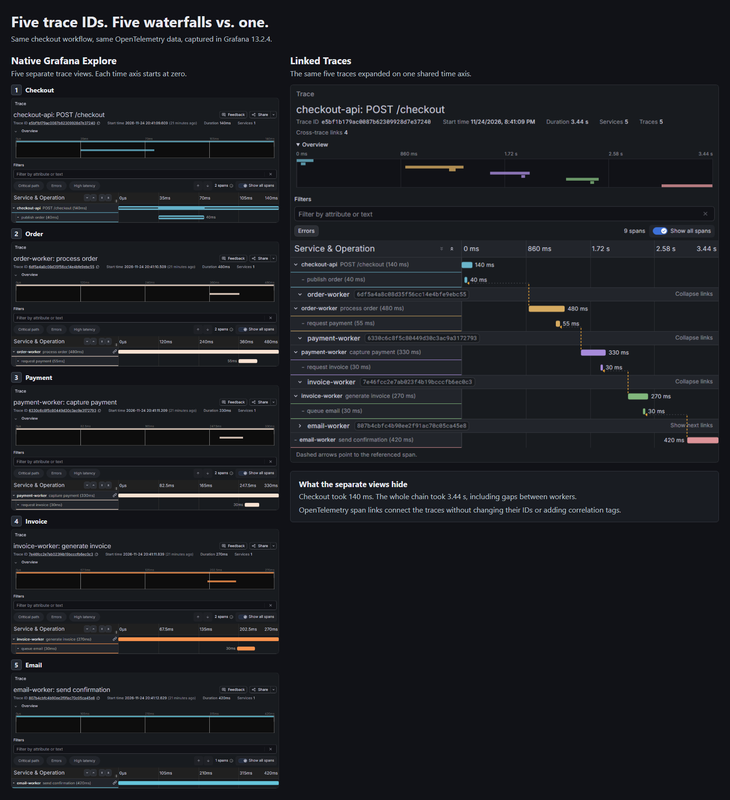

# Linked Traces for Grafana

Open either side of an OpenTelemetry span link and see both traces on a shared waterfall. The app uses existing span links: no extra attributes, changes to instrumentation, or new tracing backend are required.

**This is an unsigned prototype for local testing**, not an official Grafana plugin. The feature request is [grafana/grafana#138845](https://github.com/grafana/grafana/issues/138845).

[](docs/five-native-vs-one-linked.png)

Same five trace IDs on both sides. The checkout request took 140 ms, but the email finished 3.44 s after checkout started. The shared timeline shows the gaps between workers.

## Run locally

Requires Docker Compose and Node.js 24.5 or later.

```bash
npm ci
npm run build
docker compose up -d
node dev/seed.cjs
```

Open the **checkout-api (start here)** URL printed by the seed script and sign in to local Grafana at [localhost:3000](http://localhost:3000) with `admin` / `admin`. The checkout API and order worker appear first. Click each worker's trace header to follow the chain: order → payment → invoice → email. Each worker links back to the preceding trace; there are no extra correlation attributes. If Tempo has just started or the incoming link is not yet searchable, try **Load traces** again.

The demo uses Grafana 13.2.4, Tempo 2.9.0, and a provisioned Tempo data source. The Compose ports are bound to loopback and unsigned plugin loading is limited to this plugin. Run `docker compose down` to stop the stack. After editing `src/plugin.json`, rebuild and run `docker compose restart grafana` so Grafana rereads the metadata.

The waterfall groups spans by trace, nests them by parent span, and colors bars by service. Drag across the overview to zoom, or filter the span rows by text, attributes, or errors. Expand or collapse a span branch without changing the shared time scale. Select a span or its timeline row to open its duration, IDs, and attributes inline.

## Use with another Tempo data source

Select a Tempo data source in the app, enter a trace ID, and choose a lookback that includes the spans carrying the incoming links. The app uses Grafana's data-source proxy and the data source's existing authentication. It loads up to 20 direct neighbors per trace and only queries the next hop when you expand that trace. It does not discover unsampled or expired traces. A successful search with no results does not rule out incoming links outside the selected time range.

The local Compose stack provisions an **Open linked traces** action. In **Explore**, open a trace and expand any span to see the action. From **Traces Drilldown**, the **Open in Explore** button in the trace drawer takes you to that view.

For another Tempo source, add an [external trace correlation](https://grafana.com/docs/grafana/latest/datasources/tempo/configure-tempo-data-source/trace-correlations/) with results field `traceID` and a URL like:

```text
http://localhost:3000/a/tombiddulph-linkedtraces-app/?ds=local-tempo&traceId=$traceID
```

Use the Grafana origin and Tempo UID for your installation.

## Checks

```bash
npm run typecheck
npm run lint
npm run test:ci
npm exec playwright install chromium
npm run e2e
```

Browser tests require the local Compose stack. They send fresh OTLP data to check that the producer, worker, and link render together from either trace and that the Explore action opens the waterfall with the selected trace.
